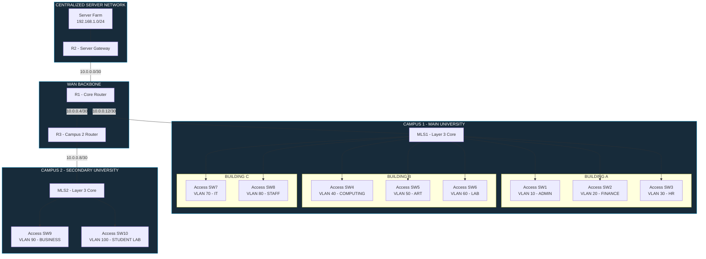

# University Campus Network
### Enterprise Multi-Campus Network Infrastructure

<p align="center">
  
  
  
 
</p>

---

## 01. Project Overview

This project implements an enterprise-grade university campus network infrastructure connecting two geographically separated campuses through a routed WAN architecture.

The network is designed to support multiple academic departments, administrative services, centralized servers, and dedicated student environments.

The architecture uses hierarchical network segmentation, Layer 3 switching, point-to-point WAN connectivity, and dynamic routing through OSPF.

**Primary Objectives**

- Build a scalable multi-campus network infrastructure.
- Implement departmental segmentation using VLANs.
- Enable inter-VLAN communication through multilayer switching.
- Establish routed connectivity between campuses.
- Integrate a centralized server network.
- Implement dynamic routing using OSPF Area 0.
- Prepare the infrastructure for advanced enterprise security controls.

## 02. Network Architecture

The infrastructure is organized into three logical network zones:

| Zone | Description | Main Components |
|---|---|---|
| Campus 1 | Main University Campus | R1, MLS1, 8 Access Switches |
| Campus 2 | Secondary Campus | R3, MLS2, 2 Access Switches |
| Server Network | Centralized Services | R2, Server LAN |

### Logical Network Topology



## 03. VLAN Architecture

Departmental segmentation is implemented to isolate traffic and organize network resources according to university departments.

### Campus 1

| VLAN ID | Department | Network Role |
|---|---|---|
| 10 | Administration | Administrative Services |
| 20 | Finance | Financial Operations |
| 30 | Human Resources | HR Services |
| 40 | Computing | Computing Department |
| 50 | Art | Academic Department |
| 60 | Lab | Laboratory Environment |
| 70 | IT | IT Infrastructure |
| 80 | Staff | University Staff |

### Campus 2

| VLAN ID | Department | Network Role |
|---|---|---|
| 90 | Business | Business Department |
| 100 | Student Lab | Student Computing Environment |

Each VLAN is associated with a dedicated Layer 3 gateway configured on its respective multilayer switch.

## 04. IP Addressing & WAN Design

The WAN backbone uses point-to-point IPv4 addressing with /30 subnets.

| Connection | Network | Prefix |
|---|---|---|
| R2 ↔ R1 | 10.0.0.0 | /30 |
| R1 ↔ R3 | 10.0.0.4 | /30 |
| R3 ↔ MLS2 | 10.0.0.8 | /30 |
| R1 ↔ MLS1 | 10.0.0.12 | /30 |

### Server Network

| Network | Address |
|---|---|
| Server LAN | 192.168.1.0/24 |

### Campus 2 Gateways

| VLAN | Gateway |
|---|---|
| VLAN 90 | 172.16.90.1 |
| VLAN 100 | 172.16.100.1 |

*Campus 1 VLAN subnet assignments will be documented in the detailed IP addressing table.*

## 05. Routing Architecture

**Open Shortest Path First (OSPF)**

OSPF is deployed as the dynamic routing protocol across the network infrastructure.

- OSPF Process: Area 0
- Routing Type: Link-State
- Backbone Area: Area 0
- Participating Devices: R1, R2, R3, MLS1 and MLS2
- Advertised Networks: WAN links, server network and campus VLAN networks.

The objective is to provide dynamic route exchange between both campuses and the centralized server network.

## 06. Infrastructure Components

| Device | Role |
|---|---|
| R1 | Main Campus Core Router |
| R2 | Server Network Router |
| R3 | Secondary Campus Router |
| MLS1 | Campus 1 Layer 3 Core Switch |
| MLS2 | Campus 2 Layer 3 Core Switch |
| 10 Access Switches | Departmental Access Layer |
| End Devices | PCs, Printers and Servers |

## 07. Technologies & Protocols

<p align="center">
  
  
  
  
  
  
</p>

## 08. Security Roadmap

The following security enhancements are planned for the infrastructure:

- Access Control Lists (ACLs)
- SSH-based device administration
- Switch Port Security
- DHCP Snooping
- Dynamic ARP Inspection
- VLAN isolation and traffic restrictions
- Secure management access

## 09. Repository Structure

```text
University-Campus-Network/
│
├── README.md
│
├── topology/
│   ├── campus-network.pkt
│   └── architecture.png
│
├── configurations/
│   ├── routers/
│   │   ├── R1.txt
│   │   ├── R2.txt
│   │   └── R3.txt
│   │
│   ├── multilayer-switches/
│   │   ├── MLS1.txt
│   │   └── MLS2.txt
│   │
│   └── access-switches/
│
├── documentation/
│   ├── ip-addressing.md
│   ├── vlan-design.md
│   ├── routing-design.md
│   └── security-design.md
│
└── tests/
    └── connectivity-tests.md
```

## 10. Project Status

| Component | Status |
|---|---|
| Network Topology | Implemented |
| WAN Connectivity | Configured |
| VLAN Architecture | Configured |
| Layer 3 Switching | Configured |
| OSPF Routing | Configured |
| Connectivity Validation | Pending Documentation |
| Enterprise Security | Planned |

## 11. Learning Outcomes

This project demonstrates practical networking skills in:

- Enterprise network architecture and design.
- Multi-campus infrastructure deployment.
- VLAN planning and network segmentation.
- Layer 2 and Layer 3 switching.
- Dynamic routing and OSPF.
- WAN addressing and point-to-point links.
- Cisco IOS configuration and troubleshooting.
- Network security planning.

---

<p align="center">
  
</p>

<p align="center">
  <strong>University Campus Network Infrastructure</strong><br/>
  Enterprise Networking | Network Engineering | Infrastructure Design
</p>
