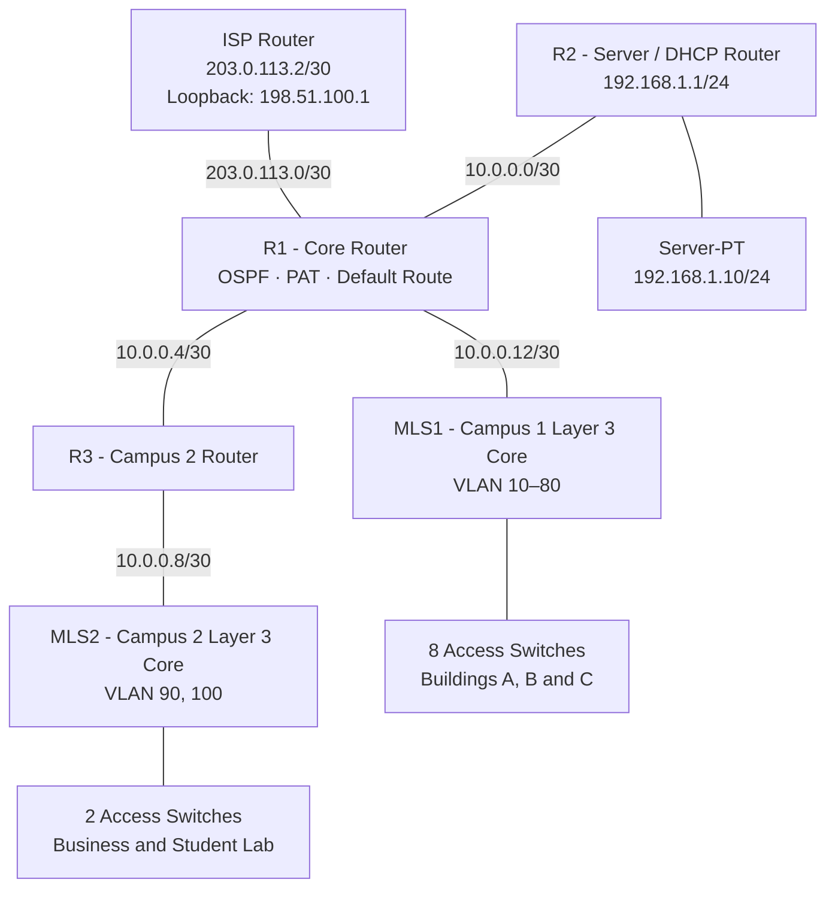

# University Campus Network
### Enterprise Multi-Campus Network Infrastructure

<p align="center">
  
  
  
  
</p>

## 01. Project Overview

An enterprise-style university network connecting two campuses and a centralized server network. The design uses departmental VLAN segmentation, Layer 3 switching, OSPF Area 0, centralized DHCP, PAT, access-control policies, and Rapid-PVST+.

The ISP router is an additional device connected to R1 to provide a simulated public test destination. It does not represent a real Internet service unless connected to a Packet Tracer Cloud or an upstream network.

## 02. Logical Architecture



## 03. Device Inventory

| Device | Role |
|---|---|
| ISP | Simulated upstream/public test network |
| R1 | Main core router, OSPF, PAT and default route |
| R2 | Central DHCP router and server LAN gateway |
| R3 | Campus 2 WAN router |
| MLS1 | Campus 1 Layer 3 core |
| MLS2 | Campus 2 Layer 3 core |
| SW1–SW8 | Department access switches |
| SW9–SW10 | Campus 2 access switches |
| Server-PT | Static server at 192.168.1.10 |

## 04. VLAN and IPv4 Plan

All departmental VLANs use /24 subnets. The SVI address ending in `.1` is the default gateway. Access switch management addresses use `.2` in the corresponding department VLAN.

| VLAN | Department | Subnet | Gateway |
|---:|---|---|---|
| 10 | Administration | 172.16.10.0/24 | 172.16.10.1 |
| 20 | Finance | 172.16.20.0/24 | 172.16.20.1 |
| 30 | Human Resources | 172.16.30.0/24 | 172.16.30.1 |
| 40 | Computing | 172.16.40.0/24 | 172.16.40.1 |
| 50 | Art | 172.16.50.0/24 | 172.16.50.1 |
| 60 | Lab | 172.16.60.0/24 | 172.16.60.1 |
| 70 | IT | 172.16.70.0/24 | 172.16.70.1 |
| 80 | Staff | 172.16.80.0/24 | 172.16.80.1 |
| 90 | Business | 172.16.90.0/24 | 172.16.90.1 |
| 100 | Student Lab | 172.16.100.0/24 | 172.16.100.1 |

### Routed links

| Link | Network | First endpoint | Second endpoint |
|---|---|---|---|
| R2–R1 | 10.0.0.0/30 | R2 .1 | R1 .2 |
| R1–R3 | 10.0.0.4/30 | R1 .5 | R3 .6 |
| R3–MLS2 | 10.0.0.8/30 | R3 .9 | MLS2 .10 |
| R1–MLS1 | 10.0.0.12/30 | R1 .13 | MLS1 .14 |
| R1–ISP | 203.0.113.0/30 | R1 .1 | ISP .2 |

Server LAN: `192.168.1.0/24`; R2 gateway `192.168.1.1`; Server-PT `192.168.1.10`.

## 05. Routing and Services

- OSPF process 10, Area 0, across R1, R2, R3, MLS1 and MLS2.
- R1 originates the default route into OSPF.
- R2 provides DHCP pools for all ten user VLANs.
- MLS1 and MLS2 use `ip helper-address 192.168.1.1` on their user SVIs.
- R1 performs PAT using its ISP-facing `GigabitEthernet0/1` interface.
- Rapid-PVST+ is enabled. Each multilayer switch is the intended STP root for its campus VLANs.

## 06. Security Policy

- Student Lab (VLAN 100) can obtain DHCP and reach the designated server for DNS, but is blocked from other RFC1918 internal networks. Other non-private destinations remain permitted for simulated Internet access.
- SSH is enabled for device management.
- VTY access is restricted to the IT subnet `172.16.70.0/24`.
- Access ports use Port Security, sticky MAC learning, a maximum of two MAC addresses, and restrict-mode violation handling.
- PortFast and BPDU Guard are enabled on endpoint ports.
- Unused access ports are administratively shut down.

**Lab credentials:** replace the example local secret `ChangeMe-SSH-2026` before sharing the project publicly. Do not reuse a real password.

## 07. Physical Interface Map

- R1 `Gi0/0` ↔ MLS1 `Gi1/0/1` (routed)
- R1 `Gi0/1` ↔ ISP `Gi0/0` (new routed link)
- R1 `Se0/0/0` ↔ R2 `Se0/0/0`
- R1 `Se0/0/1` ↔ R3 `Se0/0/1`
- R3 `Gi0/0` ↔ MLS2 `Gi1/0/1` (routed)
- MLS1 `Gi1/0/2–9` ↔ SW1–SW8 `Fa0/1`
- MLS2 `Gi1/0/2–3` ↔ SW9–SW10 `Fa0/1`
- Each access switch: `Fa0/2` = PC; `Fa0/3` = printer.

If a physical port differs in the Packet Tracer model, adjust the interface name while preserving the addressing and logical role.

## 08. Repository Structure

```text
University-Campus-Network/
├── README.md
├── topology/
│   └── architecture.mmd
├── configurations/
│   ├── routers/
│   │   ├── ISP.txt
│   │   ├── R1.txt
│   │   ├── R2.txt
│   │   └── R3.txt
│   ├── multilayer-switches/
│   │   ├── MLS1.txt
│   │   └── MLS2.txt
│   └── access-switches/
│       ├── SW1.txt ... SW10.txt
└── documentation/
    ├── IP-ADDRESSING.md
    ├── SECURITY-POLICIES.md
    └── VALIDATION.md
```

## 09. Deployment Order

1. Add the ISP router and connect R1 `Gi0/1` to ISP `Gi0/0`.
2. Configure ISP, R1, R2 and R3.
3. Configure MLS1 and MLS2.
4. Configure the ten access switches.
5. Set Server-PT to `192.168.1.10/24`, gateway `192.168.1.1`.
6. Enable DNS service on Server-PT if DNS resolution is required.
7. Set PCs to DHCP. Configure printer addressing by DHCP reservation or static addressing if desired.
8. Verify links, OSPF adjacencies, DHCP leases, inter-VLAN policy and PAT.

## 10. Validation Checklist

| Test | Command / Expected result |
|---|---|
| Interface state | `show ip interface brief` — routed links up/up |
| OSPF neighbors | `show ip ospf neighbor` — expected adjacent routers/core switches |
| OSPF routes | `show ip route ospf` — remote campus and server routes |
| VLAN database | `show vlan brief` |
| Trunks | `show interfaces trunk` |
| STP | `show spanning-tree` |
| DHCP | `show ip dhcp binding` on R2 |
| PAT | `show ip nat translations` and `show ip nat statistics` on R1 |
| ACL counters | `show access-lists` |
| Public test | From a permitted client, ping `198.51.100.1` |

## 11. Platform Notes and Limitations

This configuration targets Cisco 2911 routers, Cisco 3560-24PS multilayer switches, and Cisco 2960 access switches in Packet Tracer. IOS command support can vary by Packet Tracer device model/version.

The ISP router provides a simulated public test endpoint using Loopback0 (`198.51.100.1/32`). This validates routing and PAT inside the lab; it is not a real Internet connection.

The original topology is single-homed and has no redundant core/router links. STP is configured, but spanning tree cannot provide meaningful link redundancy until additional physical Layer 2 paths are added.

---

<p align="center">
  <strong>University Campus Network Infrastructure</strong><br/>
  Enterprise Networking | Routing & Switching | Network Security
</p>
